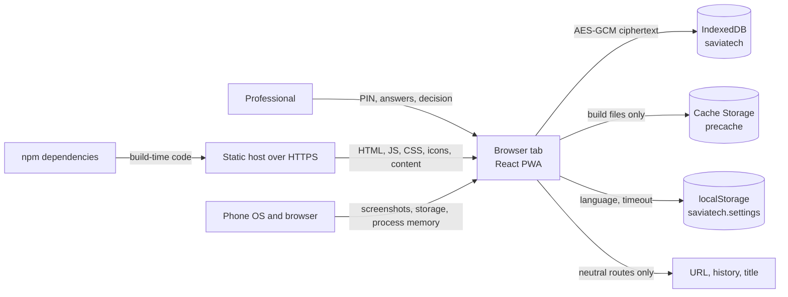

# Threat model

- Status: internal review for TR-001 task T8, version 1.0, 2026-11-03. Not an independent security
  audit and not a legal or clinical review.
- System: offline-first PWA for pseudonymous psychosocial screening by frontline professionals.
- Scope: the web client in `apps/web/`, the rules package in `packages/rules/` and the sample content
  in `content/`, as implemented by TR-001 tasks T1 to T7. No backend, accounts, synchronisation or
  multi-device access exists in v1.
- Data: pseudonymous case code, consent record, screening answers, scores, professional decision,
  justification and referral pathway. No names or direct identifiers are required, but the app does
  not prevent a professional from typing them into free text.
- Review basis: source code and tests in this repository, the measurements recorded in `README.md`,
  and the CSP behaviour documented by MDN. See [Review record](#review-record) and
  [References](#references).

> This document describes the current implementation and its limits. Do not treat it as a completed
> security review, a certification or a guarantee. Real personal data is out of scope until the open
> decisions in [Residual risk register](#7-residual-risk-register) are closed.

## 1. Method

1. List the assets, the places where they live and who can reach them.
2. List the adversaries the project is expected to face.
3. For each threat, name the control that exists today, the file or test that proves it, and the
   residual risk that remains.
4. Mark each limitation as `accepted v1`, `planned (<task>)` or `open (<owner>)`.
5. Separate what was verified locally from what still needs a human, a device, a lawyer or a Social
   Work reviewer.

The code is the source of truth. If this document and the code disagree, the code and its tests win
and this document must be corrected.

## 2. System and trust boundaries

| Boundary                             | What crosses it                                        | Why it matters                                                              |
| ------------------------------------ | ------------------------------------------------------ | --------------------------------------------------------------------------- |
| TB1: phone and browser to app        | Screen, keyboard, storage, process memory, screenshots | Anyone holding the unlocked phone is inside the session boundary.           |
| TB2: app to IndexedDB                | Encrypted case rows and plaintext crypto metadata      | A local inspector can read, copy or edit everything in IndexedDB.           |
| TB3: app to network                  | First load and update downloads; no case data          | A compromised host or update path can replace the client.                   |
| TB4: build pipeline and dependencies | npm packages, Workbox, generated service worker        | A build-time compromise ships inside the trusted app.                       |
| TB5: content pipeline                | Instrument, thresholds, consent and referral files     | Wrong clinical content can cause a wrong decision even with perfect crypto. |

## 3. Where data lives

| Data                                                                            | Location                                | At rest                                           | Visible to a local inspector                                    | Notes                                                                                             |
| ------------------------------------------------------------------------------- | --------------------------------------- | ------------------------------------------------- | --------------------------------------------------------------- | ------------------------------------------------------------------------------------------------- |
| Case payload: code, consent, screenings, final band, justification, `createdAt` | `saviatech.cases.ct` in IndexedDB       | AES-GCM 256                                       | No, ciphertext only                                             | Row is exactly `{ id, v, iv, ct, actualizadoEn }`. `id` is a random UUID.                         |
| Wrapped data key, KDF salt and iterations, failed attempts, `lockedUntil`       | `saviatech.cryptoMetadata` in IndexedDB | DEK wrapped with AES-KW 256; parameters plaintext | Yes, metadata only                                              | No PIN, KEK or clear DEK is stored. Editing this row can reset the local wait.                    |
| PIN, KEK, DEK, decrypted answers                                                | JavaScript process memory               | In memory only                                    | Only through process memory, debugging or a compromised browser | Cleared on lock on a best-effort basis.                                                           |
| Language and auto-lock timeout                                                  | `localStorage` key `saviatech.settings` | Plaintext                                         | Yes                                                             | Non-sensitive. One module, enforced by ESLint and a static test.                                  |
| App shell, manifest, icons, sample content                                      | Cache Storage precache and HTTP cache   | Plaintext                                         | Yes                                                             | Public build files, no case data. O5 checks this.                                                 |
| URL, history entry, document title                                              | Browser UI                              | Plaintext                                         | Yes                                                             | Routes and case ids stay in memory; quick exit replaces history and title on a best-effort basis. |
| Cookies, `sessionStorage`, console, analytics, error reporters, notifications   | Not used                                | Not applicable                                    | Not applicable                                                  | Enforced by code review and `static.test.ts` for console and web storage.                         |

## 4. Assets

| ID    | Asset                                                                      | Why it matters                                                         |
| ----- | -------------------------------------------------------------------------- | ---------------------------------------------------------------------- |
| AS-01 | Screening answers, scores and the professional's justification             | Can reveal violence, mental health and trauma.                         |
| AS-02 | Consent records                                                            | Legal and ethical basis for processing.                                |
| AS-03 | Data encryption key (DEK)                                                  | Decrypts every case on the device.                                     |
| AS-04 | PIN and key-encryption key (KEK)                                           | Protect the DEK.                                                       |
| AS-05 | Integrity of the instrument, thresholds, safety alert and referral content | A wrong value can cause a wrong clinical decision.                     |
| AS-06 | Wrapped DEK and crypto metadata                                            | Needed to unlock; editing it can deny service or reset the local wait. |
| AS-07 | Existence of the app and the number/recency of cases                       | Can reveal that the professional works in this domain.                 |

## 5. Adversaries

| ID  | Adversary                                                   | Capability assumed                                                                    | Not assumed                             |
| --- | ----------------------------------------------------------- | ------------------------------------------------------------------------------------- | --------------------------------------- |
| A1  | Partner, family member or acquaintance hostile to the woman | Physical access to an unlocked phone, shoulder surfing, app switcher, browser history | Breaking AES or Web Crypto              |
| A2  | Same, who knows or coerces the PIN                          | Full session access, coercion                                                         | Reading ciphertext without the PIN      |
| A3  | Someone who copies or edits device storage                  | Offline copy of IndexedDB, ability to restore or modify rows                          | Remote code execution on the device     |
| A4  | Thief or someone who finds a lost phone                     | Device access, storage copy                                                           | PIN                                     |
| A5  | Compromised dependency or build tool                        | Code execution at build time or in the bundle                                         | A compromised browser or OS             |
| A6  | Malicious or compromised hosting, DNS or update path        | Serve different HTML/JS to a new install or update                                    | Already-installed app without an update |
| A7  | Observer during a demo or training session                  | Shoulder surfing, screenshots                                                         | Device access                           |
| A8  | Professional error, stale content or a shared device        | Wrong answers, wrong referral, identifiers in free text, multiple users with one PIN  | Malice                                  |

## 6. Threat register

### 6.1 Device and session

| ID   | Threat                                                                              | Adversary | Controls and evidence                                                                                                                                                                                                                                                                                                                                                                       | Test evidence                                                                                                                                                                                                                         | Residual risk                                                                                                                                                                                      | Status                                                               |
| ---- | ----------------------------------------------------------------------------------- | --------- | ------------------------------------------------------------------------------------------------------------------------------------------------------------------------------------------------------------------------------------------------------------------------------------------------------------------------------------------------------------------------------------------- | ------------------------------------------------------------------------------------------------------------------------------------------------------------------------------------------------------------------------------------- | -------------------------------------------------------------------------------------------------------------------------------------------------------------------------------------------------- | -------------------------------------------------------------------- |
| T-01 | Someone hostile inspects an unlocked phone and reads or copies data                 | A1        | The protected tree renders only while `vaultController` reports `unlocked`; `Shell.tsx` keys it by `vaultSnapshot.epoch`, so a lock unmounts it. `autoLock.ts` locks on timeout, `visibilitychange` and `pagehide`. `quickExit.ts` locks first, then shows the neutral screen, replaces history and changes the title. The router is in memory, so routes and case ids never enter the URL. | `apps/web/src/session/__tests__/autoLock.test.ts`, `quickExit.test.ts`, `vaultController.test.ts`; `apps/web/e2e/autoLock.spec.ts`, `quickExit.spec.ts`, `pin.spec.ts`                                                                | An unlocked screen is readable. OS screenshots, the app switcher and shoulder surfing remain. There is no screen blur or FLAG_SECURE equivalent.                                                   | Implemented, residual accepted                                       |
| T-02 | Someone knows or coerces the PIN and opens the vault                                | A2        | PIN gate, auto-lock, quick exit, generic wrong-PIN message and persisted wait. There is no duress PIN, second factor or plausible deniability.                                                                                                                                                                                                                                              | `apps/web/src/crypto/__tests__/keyring.test.ts`; `apps/web/e2e/pin.spec.ts`                                                                                                                                                           | A person who knows or coerces the PIN gets every case. The app cannot distinguish the professional from an abuser.                                                                                 | Accepted v1; needs a Social Work protocol and a future duress design |
| T-03 | An attacker copies storage and brute-forces the PIN offline                         | A3        | PBKDF2-HMAC-SHA256 with 600,000 iterations and a random 16-byte salt; AES-KW 256 wrapped DEK; AES-GCM 256 records; six-digit minimum PIN; waits of 0, 0, 5 s, 30 s and 5 min; attempts serialised per keyring.                                                                                                                                                                              | `apps/web/src/crypto/__tests__/keyring.test.ts` (iterations, lockout, concurrent wrong PINs, lock races), `recordCipher.test.ts`                                                                                                      | A six-digit PIN space is small. A storage copy can be attacked offline; the in-app wait does not apply. A longer passphrase and a recovery policy are future work.                                 | Accepted v1; passphrase planned in TR-002                            |
| T-04 | Sensitive data leaks through the platform                                           | A1, A3    | Only `{ id, v, iv, ct, actualizadoEn }` is stored in `cases`; the payload is encrypted. `cryptoMetadata` holds no PIN, KEK or clear DEK. `localStorage` holds only language and timeout. There are no cookies, `sessionStorage`, console output, analytics, error reporters or case data in URLs. CSP uses `connect-src 'self'`; there are no runtime third-party requests.                 | `apps/web/src/storage/__tests__/caseRepository.test.ts` T4-02; `apps/web/src/crypto/__tests__/static.test.ts`; `apps/web/src/settings/__tests__/settingsStore.test.ts`; `apps/web/e2e/offline.spec.ts` O5; `apps/web/e2e/csp.spec.ts` | Case count and recency, the database and table names, and the app's existence are visible. Direct identifiers typed into free text are stored inside the encrypted payload.                        | Implemented                                                          |
| T-05 | An attacker tampers with a stored record                                            | A3        | AES-GCM authenticates each record with `table`, `id` and `version` as AAD. `parseCasePayload` validates the decrypted shape. `update` compares `actualizadoEn` in a short transaction. Unreadable rows are reported in `unreadableIds` without aborting the page.                                                                                                                           | `apps/web/src/crypto/__tests__/recordCipher.test.ts` (tamper, AAD, wrong key); `apps/web/src/storage/__tests__/caseRepository.test.ts` T4-04, T4-07, T4-08                                                                            | There is no anti-rollback. An attacker who can write IndexedDB can restore an older valid ciphertext for the same table, id and version.                                                           | Partial                                                              |
| T-06 | An attacker edits lockout metadata to bypass the wait                               | A3        | Failed attempts and `lockedUntil` are persisted; keyring operations are serialised; a generation counter prevents an in-flight unlock from publishing a key after a lock.                                                                                                                                                                                                                   | `apps/web/src/crypto/__tests__/keyring.test.ts` (persisted lockout, concurrent attempts, lock during unlock)                                                                                                                          | The wait is a local brake only. An attacker who can edit IndexedDB can reset it.                                                                                                                   | Accepted v1                                                          |
| T-07 | A compromised dependency executes code or exfiltrates data                          | A5        | Minimal dependency set; lockfile; permissive-licence check in CI; no runtime third-party calls; CSP; scoped ESLint rules; no console; no web storage in the crypto module; no `eval`, `new Function` or dangerous HTML in source.                                                                                                                                                           | `npm run licenses`; `apps/web/src/crypto/__tests__/static.test.ts`; `apps/web/e2e/csp.spec.ts`; `scripts/check-budget.mjs`; the e2e fixture blocks external requests                                                                  | A build-time compromise of npm packages ships inside the app. There is no SRI and no reproducible build. `.opencode/` contains third-party material and is a separate repository-hygiene decision. | Partial                                                              |
| T-08 | A lost or stolen device causes data loss                                            | A4        | PIN; persistent storage is requested after unlock; the UI warns when the browser denies it; there is no cloud backup.                                                                                                                                                                                                                                                                       | `apps/web/src/storage/__tests__/persistence.test.ts`; `apps/web/e2e/settings.spec.ts`                                                                                                                                                 | The OS or browser may evict storage. A forgotten PIN makes local data unrecoverable.                                                                                                               | Accepted v1                                                          |
| T-09 | Shoulder surfing during a demo or training exposes a case                           | A7        | Synthetic data only; quick exit; neutral screen; the demo steps in `README.md` use synthetic fixtures.                                                                                                                                                                                                                                                                                      | `apps/web/e2e/fixtures.ts`; `apps/web/e2e/quickExit.spec.ts`                                                                                                                                                                          | Shoulder surfing and screenshots remain possible.                                                                                                                                                  | Accepted v1                                                          |
| T-10 | A malicious host or update path serves modified code                                | A6        | HTTPS; same-origin service worker and assets; `skipWaiting` and `clientsClaim` are off; updates require an explicit action and are blocked while the vault is unlocked; the precache is audited to contain only build files; CSP limits scripts to `'self'`.                                                                                                                                | `apps/web/src/pwa/__tests__/swStatus.test.ts`; `apps/web/e2e/offline.spec.ts` O1 and O5; `scripts/check-budget.mjs`; `apps/web/e2e/csp.spec.ts`                                                                                       | A compromised host, DNS or update path can serve malicious code to a new install or update. There is no SRI, release signature or reproducible build.                                              | Partial; deployment decision                                         |
| T-11 | The app is framed by another site (clickjacking)                                    | A6        | The CSP meta in `apps/web/index.html` sets `default-src 'self'`, `script-src 'self'`, `connect-src 'self'`, `img-src 'self' data:`, `object-src 'none'` and `base-uri 'none'`. `frame-ancestors`, `sandbox` and `report-uri` are not supported in a `<meta>` element and must be sent as HTTP headers by the host.                                                                          | `scripts/check-budget.mjs` audits the meta CSP; `apps/web/e2e/csp.spec.ts` checks no inline scripts/styles and no CSP violations; no header test exists                                                                               | If the host does not send `frame-ancestors` or `X-Frame-Options`, the app can be framed. There is no CSP reporting endpoint.                                                                       | Open (deployment owner)                                              |
| T-12 | Cross-site scripting executes attacker code                                         | A5, A6    | React escapes text by default; source has no `dangerouslySetInnerHTML`, `innerHTML`, `eval` or `new Function`; CSP allows scripts only from `'self'`; there are no inline scripts or third-party scripts.                                                                                                                                                                                   | `apps/web/e2e/csp.spec.ts`; static inspection of `apps/web/src/`; no dedicated XSS test                                                                                                                                               | A future change could introduce dangerous HTML. CSP is the main brake.                                                                                                                             | Partial                                                              |
| T-13 | Clinical content is altered in the build or deployment                              | A6, A8    | Startup validation checks the instrument, consent and referral files; `SAMPLE` status is required; referral priority bands must exist in the instrument; invalid content blocks case creation and screening with a generic message.                                                                                                                                                         | `apps/web/src/content/__tests__/content.test.ts`                                                                                                                                                                                      | There is no content signature or version pinning. A compromised build can change thresholds or routes. Social Work review is still pending.                                                        | Partial                                                              |
| T-14 | The tool is used with a minor, in the wrong territory, or consent is revoked        | A8        | None in v1. Only synthetic data is acceptable. The documentation states the limits.                                                                                                                                                                                                                                                                                                         | Not applicable                                                                                                                                                                                                                        | The app cannot detect age, minor status or territory, and it cannot delete a case or revoke consent.                                                                                               | Open (legal and Social Work owners)                                  |
| T-15 | A stale or invented referral sends a woman to the wrong service                     | A8        | Referral files are `SAMPLE`; each service carries `lastVerified`; priority bands are validated; referrals are not stored.                                                                                                                                                                                                                                                                   | `apps/web/src/content/__tests__/content.test.ts`; `apps/web/e2e/flows.spec.ts`                                                                                                                                                        | Sample contacts must be replaced before any pilot. The app does not track whether a referral was agreed, sent or confirmed.                                                                        | Accepted v1; Social Work review pending                              |
| T-16 | A low band falsely reassures the professional                                       | A8        | The result states that the tool does not diagnose; the professional chooses the final band; a changed band requires a written justification; the safety alert is shown when the safety item is positive.                                                                                                                                                                                    | `apps/web/e2e/flows.spec.ts`; `apps/web/src/flows/` reducers; `apps/web/src/storage/__tests__/caseRepository.test.ts` T4-07                                                                                                           | A low score can still hide risk. There is no clinical validation of the instrument or thresholds.                                                                                                  | Open (clinical owner)                                                |
| T-17 | The browser evicts the vault                                                        | A8        | Persistent storage is requested after unlock; the UI warns when it is denied; no backup exists.                                                                                                                                                                                                                                                                                             | `apps/web/src/storage/__tests__/persistence.test.ts`; `apps/web/e2e/settings.spec.ts`                                                                                                                                                 | Eviction can lose data. Persistent storage is not guaranteed.                                                                                                                                      | Accepted v1                                                          |
| T-18 | Two tabs hold independent unlocked vaults or race on writes                         | A3, A8    | The repository detects concurrent updates inside one database with an optimistic `actualizadoEn` comparison. There is no cross-tab lock or attempt-count coordination.                                                                                                                                                                                                                      | `apps/web/src/storage/__tests__/caseRepository.test.ts` T4-08                                                                                                                                                                         | Two tabs can hold independent keyrings. Concurrent `initialize` or `changePin` from two tabs can overwrite metadata. Setup and PIN changes must be single-tab for now.                             | Open (TR-002)                                                        |
| T-19 | The app switcher or browser history keeps a screenshot or title                     | A1        | Quick exit locks first, shows the neutral screen, replaces the current history entry and changes the document title. The protected tree unmounts on lock.                                                                                                                                                                                                                                   | `apps/web/src/session/__tests__/quickExit.test.ts`; `apps/web/e2e/quickExit.spec.ts`                                                                                                                                                  | The OS may retain a screenshot of the previous screen, and the browser may keep history entries the app cannot remove.                                                                             | Accepted v1                                                          |
| T-20 | An update interrupts a screening or applies itself                                  | A8        | Updates are explicit; `swStatus.ts` blocks applying an update while the vault is unlocked; `skipWaiting` and `clientsClaim` are off.                                                                                                                                                                                                                                                        | `apps/web/src/pwa/__tests__/swStatus.test.ts`; `apps/web/e2e/settings.spec.ts`                                                                                                                                                        | A professional can ignore the update; old versions can remain on phones that never open the app online.                                                                                            | Implemented                                                          |
| T-21 | Browser autofill or visited-link styling leaks case data                            | A1        | Case data never enters the URL; the router is in memory; the PIN field is cleared after every submit; no persistent form fields carry case data between screens.                                                                                                                                                                                                                            | `apps/web/src/router/__tests__/router.test.ts`; `apps/web/src/session/__tests__/quickExit.test.ts`; `apps/web/e2e/pin.spec.ts`                                                                                                        | Browser autofill and `:visited` behaviour are outside the app's control.                                                                                                                           | Accepted v1                                                          |
| T-22 | The database or table name reveals the app's purpose                                | A1, A3    | Documented limit. The database is `saviatech` and the table is `cases`; the app does not try to hide them.                                                                                                                                                                                                                                                                                  | `apps/web/src/storage/__tests__/caseRepository.test.ts` T4-02; ADR-0009                                                                                                                                                               | A local inspector can infer the purpose from the names.                                                                                                                                            | Accepted v1 (ADR-0009)                                               |
| T-23 | Case count and recency are visible                                                  | A1, A3    | `actualizadoEn` is plaintext ordering metadata, not clinical evidence. The payload is encrypted.                                                                                                                                                                                                                                                                                            | `apps/web/src/storage/__tests__/caseRepository.test.ts` T4-02                                                                                                                                                                         | The number of cases and when each was last updated are visible.                                                                                                                                    | Accepted v1                                                          |
| T-24 | A professional cannot change a compromised PIN                                      | A2, A8    | The keyring implements `changePin` and re-wraps the DEK without re-encrypting cases, but the UI does not expose it.                                                                                                                                                                                                                                                                         | `apps/web/src/crypto/__tests__/keyring.test.ts` (change PIN); no UI test                                                                                                                                                              | If someone knows the current PIN, the professional cannot change it from the app.                                                                                                                  | Open (ADR-0013, decision D6)                                         |
| T-25 | Decrypting a page is too slow on a low-end Android phone                            | A8        | `list` decrypts only the requested page; the bundle budget is enforced; a performance spec exists.                                                                                                                                                                                                                                                                                          | `apps/web/src/storage/__tests__/caseRepository.test.ts` T4-09; `apps/web/e2e/perf.spec.ts`; `npm run budget`                                                                                                                          | The real low-end Android measurement is still pending (T7-20).                                                                                                                                     | Pending (T7-20)                                                      |
| T-26 | iOS Safari evicts storage independently of the home-screen app                      | A8        | Persistent storage is requested; the limitation is documented.                                                                                                                                                                                                                                                                                                                              | No iOS test exists                                                                                                                                                                                                                    | WebKit may evict data for sites that are not used often. This needs verification against current WebKit behaviour before it is stated as a guarantee.                                              | Open (verification)                                                  |
| T-27 | The professional forgets the PIN                                                    | A8        | None. There is no recovery path.                                                                                                                                                                                                                                                                                                                                                            | Not applicable                                                                                                                                                                                                                        | Local data is unrecoverable.                                                                                                                                                                       | Accepted v1                                                          |
| T-28 | The installed app's name and icon are visible                                       | A1        | The manifest uses a neutral name and geometric icons, with no description, categories, shortcuts or screenshots; sensitive terms are rejected.                                                                                                                                                                                                                                              | `apps/web/src/pwa/__tests__/manifest.test.ts`; `apps/web/e2e/installability.spec.ts`                                                                                                                                                  | The app's existence is visible on the home screen and in the app switcher.                                                                                                                         | Accepted v1                                                          |
| T-29 | A professional types a name, phone number or address into the code or justification | A8        | The UI asks for a pseudonymous code; no direct identifiers are required. The payload is encrypted. There is no PII detection or warning.                                                                                                                                                                                                                                                    | `apps/web/src/i18n/es.json`, `en.json`; `apps/web/src/ui/screens/NewCaseScreen.tsx`, `ResultScreen.tsx`; no automated PII test                                                                                                        | Identifiers can be stored inside the encrypted payload, where they remain until the case is deleted. v1 has no deletion.                                                                           | Accepted v1; training and a future validation                        |
| T-30 | A shared device gives everyone with the PIN access to every case                    | A8        | One local vault; no accounts, roles or per-user attribution.                                                                                                                                                                                                                                                                                                                                | Not applicable                                                                                                                                                                                                                        | There is no audit trail of who read or changed a case. A shared device is effectively a shared account.                                                                                            | Accepted v1; protocol decision                                       |
| T-31 | A case cannot be deleted or consent revoked                                         | A8        | None in v1.                                                                                                                                                                                                                                                                                                                                                                                 | Not applicable                                                                                                                                                                                                                        | The professional cannot delete a case or record a withdrawal of consent.                                                                                                                           | Open (legal and Social Work owners)                                  |
| T-32 | The consent text is not legally reviewed                                            | A8        | Consent is mandatory before `repository.create`; the file is `SAMPLE` and validated; the checkbox and continue button stay disabled until accepted.                                                                                                                                                                                                                                         | `apps/web/src/content/__tests__/content.test.ts`; `apps/web/e2e/flows.spec.ts`                                                                                                                                                        | The text, legal basis and withdrawal process are not approved.                                                                                                                                     | Open (legal owner)                                                   |

### 6.2 Storage and cryptography

The register above covers the storage and cryptography threats (T-03 to T-06, T-18, T-22, T-23). The
implemented controls are listed again with their code paths in
[Appendix A](#appendix-a-implemented-controls-by-task) so an auditor can follow each decision.

### 6.3 Platform, supply chain and deployment

The register above covers the platform and supply-chain threats (T-07, T-10 to T-13, T-20, T-25,
T-26). Deployment headers are the main gap: the repository ships a meta CSP, but
`frame-ancestors`, `sandbox` and `report-uri` are ignored in a `<meta>` element and must be set by the
host. This is a deployment decision, not a code change in this task.

### 6.4 Clinical content and governance

The register above covers the clinical and governance threats (T-13 to T-16, T-29 to T-32). The
project cannot close these with code alone. They need Social Work review, a legal review and a
written protocol for minors, consent withdrawal and referral follow-up.

## 7. Residual risk register

| Rank | Residual risk                                                                 | Why it remains                                                                                                                         | Owner                                        | Missing decision                                                                                                |
| ---- | ----------------------------------------------------------------------------- | -------------------------------------------------------------------------------------------------------------------------------------- | -------------------------------------------- | --------------------------------------------------------------------------------------------------------------- |
| 1    | A person who knows or coerces the PIN gets the data (T-02)                    | The app cannot tell the professional from an abuser. There is no duress PIN, second factor or plausible deniability.                   | Psychosocial Director and Technical Director | A safety protocol for coerced access and a future duress design.                                                |
| 2    | A copied vault can be brute-forced offline (T-03)                             | A six-digit PIN is small; the in-app wait does not apply to a copied database.                                                         | Technical Director                           | Passphrase option, recovery policy and a decision on the minimum PIN length for real data.                      |
| 3    | A compromised host or update path can ship malicious code (T-10)              | The app is static; the host, DNS and update path are outside the repository. There is no SRI, release signature or reproducible build. | Technical Director                           | Hosting controls, release integrity and a deployment checklist.                                                 |
| 4    | Clinical content can be wrong or altered (T-13, T-15, T-16)                   | The sample files are not reviewed and there is no content signature or version pinning.                                                | Psychosocial Director                        | Social Work review of every instrument, threshold, safety text and referral route; a content versioning policy. |
| 5    | Minors, consent withdrawal and legal basis are not handled (T-14, T-31, T-32) | v1 has no age, minor status, territory, deletion or revocation.                                                                        | Legal owner and Social Work owner            | Legal review, minors protocol and a deletion/consent-withdrawal policy.                                         |
| 6    | The safety alert appears only after the last question (T-16)                  | The protocol is shown at the end of the screening, not as soon as the safety item is answered.                                         | Social Work owner                            | A decision on showing the protocol earlier without increasing risk.                                             |
| 7    | The PIN cannot be changed from the UI (T-24)                                  | The keyring supports it, but no screen exposes it.                                                                                     | Technical Director                           | ADR-0013 decision D6.                                                                                           |
| 8    | Two tabs can race (T-18)                                                      | There is no cross-tab lock or attempt-count coordination.                                                                              | Technical Director                           | TR-002 design.                                                                                                  |
| 9    | The database name reveals the purpose (T-22)                                  | Accepted as a v1 limit; the app does not hide it.                                                                                      | Technical Director                           | ADR-0009 records the decision; no further action in T8.                                                         |

## 8. Known limitations

Each limitation is marked `accepted v1`, `planned (<task>)` or `open (<owner>)`.

### PIN, keys and recovery

- A PIN-derived key can be brute-forced offline if an attacker copies storage. The 600,000 PBKDF2
  iterations raise the cost but do not eliminate it. `Status: accepted v1; passphrase planned in TR-002`.
- The in-app lockout is not a defence against an attacker who copies or edits IndexedDB. It only slows
  repeated attempts on the device. `Status: accepted v1`.
- Locking removes keys and decrypted state from memory on a best-effort basis. Browser memory
  management cannot be fully controlled. `Status: accepted v1`.
- Forgetting the PIN makes local data unrecoverable in v1. `Status: accepted v1`.
- The UI does not offer a PIN change. If someone knows the current PIN, the professional cannot change
  it from the app. `Status: open (ADR-0013, decision D6)`.

### Storage and integrity

- The database name `saviatech` and the table name `cases` are visible in IndexedDB. `Status: accepted
v1 (ADR-0009)`.
- `actualizadoEn` is plaintext and unauthenticated. The number of cases and their recency are visible,
  even though their content is encrypted. `Status: accepted v1`.
- There is no anti-rollback protection. An attacker who can write IndexedDB can restore an older
  ciphertext for the same table, id and version, and it will decrypt. `Status: open (future task)`.
- Two browser tabs can hold independent unlocked keyrings; cross-tab lock, attempt-count and case
  write coordination is still open. Concurrent `initialize` or `changePin` from two tabs can overwrite
  the metadata row, so setup and PIN changes must be single-tab for now. `Status: open (TR-002)`.
- The precache and IndexedDB can be evicted by the operating system or the browser. Persistent storage
  is requested but not guaranteed. `Status: accepted v1`.
- v1 has no deletion, export or backup. A case cannot be deleted and consent cannot be revoked.
  `Status: open (legal and Social Work owners)`.
- There is no per-user attribution or audit trail. A shared device is effectively a shared account.
  `Status: accepted v1; protocol decision`.
- The app does not detect direct identifiers typed into the pseudonymous code or the justification.
  `Status: accepted v1; training and a future validation`.
- On iOS Safari, WebKit limits storage for sites that are not used often and may evict data
  independently of the home-screen app. This needs verification against current WebKit documentation
  before it is stated as a guarantee; Safari and an installed home-screen app behave differently.
  `Status: open (verification)`.
- The low-end Android measurement for listing and decrypting pages is still pending.
  `Status: pending (T7-20)`.

### Session and UI

- An unlocked screen is readable. The OS app switcher may retain a screenshot until it discards it,
  and the browser may keep history entries the app cannot remove. `Status: accepted v1`.
- A lock or quick exit during screening discards the answers by design. Pausing and resuming an
  encrypted session is TR-002. `Status: planned (TR-002)`.
- Quick exit and history replacement are best effort and vary by browser. `Status: accepted v1`.
- Android Back leaves the app instead of moving through in-app screens. Users rely on the on-screen
  Back button. `Status: accepted v1`.
- `saviatech.settings` is visible and writable by anyone with local access. It contains only language
  and timeout; it protects nothing and an invalid value falls back to the default. `Status: accepted
v1`.
- The retry countdown is known only after the keyring rejects an attempt; the UI does not read
  metadata ahead of time. `Status: accepted v1`.
- The installed name and icon are visible on the home screen and in the app switcher. They are
  neutral by design but cannot be hidden. `Status: accepted v1`.
- The service-worker precache is visible in the browser's site data. It contains only build files and
  no case data; O5 checks this on every run. `Status: accepted v1`.

### PWA, updates and deployment

- An update requires network access and an explicit action by the professional. Phones that never
  open the app online can stay on an old version, and the update cannot be applied while the vault is
  unlocked. `Status: accepted v1`.
- The update was verified on Chromium with two builds (see `README.md`). A real low-end Android phone
  in airplane mode is still pending (T7-20) and is not claimed as done. `Status: pending (T7-20)`.
- The repository ships a meta CSP. `frame-ancestors`, `sandbox` and `report-uri` are not supported in
  a `<meta>` element; the host must send them as HTTP headers. `Status: open (deployment owner)`.
- There is no SRI, release signature or reproducible build. `Status: open (deployment owner)`.

### Clinical content and governance

- The safety alert appears only after the last question. A professional who stops before the end does
  not see the protocol. Showing it as soon as the safety item is answered needs Social Work review.
  `Status: open (Social Work owner)`.
- The referral screen suggests a sample route and records nothing. It does not track whether a
  referral was agreed, sent or confirmed, and the sample contacts must be replaced before any pilot.
  `Status: accepted v1; Social Work review pending`.
- A low band can falsely reassure the professional. The tool does not diagnose, but there is no
  clinical validation of the instrument, thresholds or safety text. `Status: open (clinical owner)`.
- The consent text is `SAMPLE` and is not legally reviewed. `Status: open (legal owner)`.
- v1 cannot detect a minor, the territory or a revoked consent. `Status: open (legal and Social Work
owners)`.

## 9. Out of scope for v1

Backend, accounts, synchronisation, DHIS2, push notifications, analytics, error reporting,
multi-device access, real personal data, a public pilot and any claim of clinical validation.

## 10. What this review does not cover

- No penetration test, fuzzing or independent security audit.
- No legal review, data-protection impact assessment or Social Work review.
- No physical low-end Android phone, no iOS device and no browser matrix beyond Chromium.
- No deployment configuration: HTTPS, HSTS, `frame-ancestors`, `sandbox`, `report-uri`, cache headers
  and release integrity are host responsibilities.
- No verification of the sample clinical content or the referral routes.
- No guarantee that the browser or operating system will not retain screenshots, history or memory.

## Review record

| Item              | Value                                                                                                                                                                                   |
| ----------------- | --------------------------------------------------------------------------------------------------------------------------------------------------------------------------------------- |
| Review type       | Internal, code-and-test review for T8; not independent                                                                                                                                  |
| Date              | 2026-11-03                                                                                                                                                                              |
| Code baseline     | TR-001 T7 implementation (`7a7061e`); documentation branch `docs/t8-documentacion`                                                                                                      |
| Local commands    | `npm ci`, `npm run lint`, `npm run typecheck`, `npm test`, `npm run build`, `npm run budget`, `npm run licenses`                                                                        |
| Local environment | Windows, Node v24.19.0, npm 11.20.0                                                                                                                                                     |
| Unit result       | 275 tests passed on the second run (224 web + 51 rules). The first run hit a 5 s timeout in `caseRepository.test.ts` T4-09 under parallel load; the test passed alone and on the rerun. |
| Build result      | JS 126,449 B, CSS 1,545 B, `index.html` 969 B, `sw.js` 15,762 B, precache 436,541 B (12 entries). `npm run budget` passed.                                                              |
| Licence result    | 459 packages, all permissive.                                                                                                                                                           |
| E2E result        | 28 Playwright tests passed on Chromium on 2026-11-03 (lock, quick exit, flows, CSP, offline, installability and settings). Not run on a physical phone.                                 |
| Next review       | Before any pilot with real data, after TR-002 and after any change to crypto, lock, content or deployment headers.                                                                      |

## Appendix A. Implemented controls by task

### Encryption controls (T3)

- PIN-derived KEK: PBKDF2-HMAC-SHA256, SHA-256, 256-bit output, random 16-byte salt and 600,000
  iterations stored in metadata. Code: `apps/web/src/crypto/kdf.ts`, `constants.ts`.
- KEK: AES-KW 256, non-extractable, usages `wrapKey` and `unwrapKey`. Code: `keyring.ts`.
- DEK: AES-GCM 256, random, stored only wrapped, non-extractable while unlocked.
- Record encryption: AES-GCM with a fresh 12-byte IV, 128-bit tag and `table|id|version` AAD. Code:
  `recordCipher.ts`.
- Metadata: one Dexie row with KDF parameters, wrapped DEK, failed attempts and `lockedUntil`. No PIN,
  KEK or clear DEK. Code: `metadata.ts`, `storage/cryptoMetadataStore.ts`.
- Failed attempts: persisted waits of 0, 0, 5 seconds, 30 seconds and 5 minutes. Success resets them.
  Operations are serialised per keyring so a double submit cannot lose increments.
- Lock races: `lock()` increments a generation counter. An `unlock` or `changePin` still in flight
  cannot publish a key after the lock.
- The DEK is never passed to callers. `withDataKey` gives a bounded session whose `encrypt` and
  `decrypt` re-check the lock state.
- Metadata validation: version, algorithms, exact salt and wrapped-key sizes, minimum iterations and
  counters. Corrupt metadata fails as corrupt data, not as a wrong PIN.
- Code controls: no console output, no web storage and no external crypto imports inside
  `apps/web/src/crypto`; PBKDF2 and browser crypto only. Enforced by `static.test.ts` and
  `eslint.config.js`.
- Tests: wrong PIN, tampered ciphertext, changed AAD, unique IVs, non-extractable keys, persisted
  lockout, concurrent wrong PINs, lock during unlock and PIN change without re-encrypting records.

### Storage controls (T4)

- Dexie database `saviatech`: version 2 keeps `cryptoMetadata` and adds `cases` with primary key `id`
  and index `actualizadoEn`. The version 1 to 2 upgrade preserves the metadata row. Code: `db.ts`.
- One case is one encrypted record. The row is exactly `{ id, v, iv, ct, actualizadoEn }`.
- `id` is a random UUID generated with Web Crypto. `actualizadoEn` is ordering metadata. `createdAt`,
  the pseudonymous code, consent and screenings live inside `ct`.
- `create` and `update` validate the payload with `parseCasePayload`; a changed final band without a
  written justification is rejected.
- `list` decrypts only the requested page. A row that fails authentication or validation is reported
  in `unreadableIds` without aborting the rest of the page.
- `update` uses optimistic comparison: it decrypts and encrypts outside the IndexedDB transaction, then
  compares `actualizadoEn` in a short read-write transaction. No Web Crypto call runs inside it.
- `changePin` re-wraps the DEK only; case rows are not re-encrypted.
- `requestPersistentStorage` and `estimateStorage` wrap `navigator.storage`. The shell requests
  persistence after unlock and Home/Settings show the result.
- Tests prove that a raw IndexedDB dump contains no case code, justification, instrument id or payload
  field name, and that moved or altered ciphertext fails authentication.

### UI shell controls (T5)

- The shell renders protected screens only while `vaultController` reports `unlocked`. The protected
  tree is keyed by the vault epoch, so every lock unmounts it instead of hiding it with CSS. Code:
  `Shell.tsx`.
- The PIN is read from the DOM only when the form is submitted and is cleared in `finally`, including
  validation failures. It is never copied to React state, storage, URLs, logs or error messages. Code:
  `PinSetupScreen.tsx`, `PinUnlockScreen.tsx`, `PinInput.tsx`.
- Wrong PINs show a generic message. A lock during setup or unlock is silent and never publishes
  `unlocked`. The retry countdown is shown only after the keyring rejects an attempt.
- Automatic lock compares the deadline against the last activity, locks immediately on
  `visibilitychange`/`pagehide`, and offers only 1, 2 or 5 minutes. Code: `autoLock.ts`,
  `settingsStore.ts`.
- Quick exit locks first, then shows the neutral "Notas" screen, replaces the current history entry and
  changes the document title. It is synchronous and works from the PIN screens too. Code:
  `quickExit.ts`, `createApp.ts`.
- The router is in memory and the URL never contains routes or case ids. Code: `router.ts`.
- `localStorage` is limited to `saviatech.settings` (language and timeout) through one module. ESLint
  and a static test forbid it elsewhere.
- Persistent storage is requested after a successful setup or unlock, never at import time.

### Case-flow controls (T6)

- Consent is mandatory before `repository.create`; the checkbox and the continue button stay disabled
  until it is accepted.
- Screening answers, the safety alert step, the final band and the justification live only in React
  state and are registered with `volatileState`, so a lock or quick exit clears them. Nothing is
  written until the professional confirms the result.
- A screening is written once with `repository.update`; the repository still rejects a changed final
  band without a non-blank justification. The UI also disables saving until the justification exists.
- Asynchronous repository results compare the vault epoch captured before the request and are dropped
  after a lock. Mounted flags prevent navigation after unmount.
- The safety alert uses `role="alert"` and has one exit button. It cannot be dismissed with Escape or a
  click outside.
- The result shows the score, the calculated band, the answers of value 2 or more, and an explicit
  note that the tool does not diagnose. The final band is the professional's decision.
- The referral route uses the last screening's final band or `safetyAlert` and the `priorityBands`
  declared in `content/referral/`. Referrals are not stored.
- Clinical content is validated at startup. Invalid content blocks case creation and screening with a
  generic translated message instead of exposing validation paths.
- Case ids remain in memory only; the URL never contains a route or a case id.
- Tests cover the full flow with and without alert, justification enforcement, lock mid-screening,
  quick exit from the result, language switching without losing answers, and CSP/console/network
  checks on every new screen.

### PWA controls (T7)

- The build generates one `dist/sw.js` with `generateSW` and an inlined Workbox runtime. `skipWaiting`
  and `clientsClaim` are disabled, so a new worker waits and never takes over on its own.
- The precache contains only files from the build: HTML, hashed JS/CSS, the manifest, icons and the
  two service-worker chunks. There is no runtime caching, no `importScripts` and no third-party URL
  except the documented Workbox warning string `https://bit.ly/wb-precache`.
- `navigateFallback` serves `index.html` for in-app navigations. The worker does not cache API
  responses because v1 has no API.
- The update notice is shown in Settings while the vault is unlocked. Applying it is an explicit
  action and is blocked while the vault is unlocked, so a screening in progress is not lost. Code:
  `swStatus.ts`, `SettingsScreen.tsx`.
- The web manifest uses a neutral name and geometric icons, with no description, categories,
  shortcuts or screenshots. It is visible on the home screen and in the app switcher. Code:
  `manifest.ts`.
- `npm run budget` audits the HTML (one manifest link, no inline script/style, unchanged CSP), the
  precache (same origin, files exist, no `sw.js`), the manifest (forbidden fields and sensitive
  terms) and the icons (PNG signature and real dimensions). CI runs it after the build. Code:
  `scripts/check-budget.mjs`.
- Playwright covers installation, cold start offline, the full flow offline, first use offline, cache
  contents and installability. O5 checks that the case code, the PIN and the justification are absent
  from the caches and that `localStorage` only contains `saviatech.settings`.

## References

- MDN, `Content-Security-Policy: frame-ancestors`:
  https://developer.mozilla.org/en-US/docs/Web/HTTP/Reference/Headers/Content-Security-Policy/frame-ancestors
- MDN, `Content-Security-Policy: sandbox`:
  https://developer.mozilla.org/en-US/docs/Web/HTTP/Reference/Headers/Content-Security-Policy/sandbox
- MDN, `Content-Security-Policy: report-uri`:
  https://developer.mozilla.org/en-US/docs/Web/HTTP/Reference/Headers/Content-Security-Policy/report-uri
- W3C, Content Security Policy Level 3: https://www.w3.org/TR/CSP3/
- `docs/specs/TR-001-vertical-slice.md`, `docs/specs/T7-pwa-offline-requerimiento.md`,
  `docs/specs/T8-documentacion-requerimiento.md`
- `docs/adr/0001-monorepo-and-tooling.md`, `docs/adr/0002-instrument-validation.md`,
  `docs/adr/0003-local-encryption.md`, `docs/adr/0004-language-conventions.md`,
  `docs/adr/0005-case-storage.md`, `docs/adr/0006-ui-shell.md`,
  `docs/adr/0007-case-flows.md`, `docs/adr/0008-pwa-offline.md`,
  `docs/adr/0009-database-name.md`, `docs/adr/0010-demo-instrument-and-content.md`,
  `docs/adr/0011-v1-scope.md`, `docs/adr/0012-csp-and-hosting-headers.md`,
  `docs/adr/0013-pin-policy.md`
